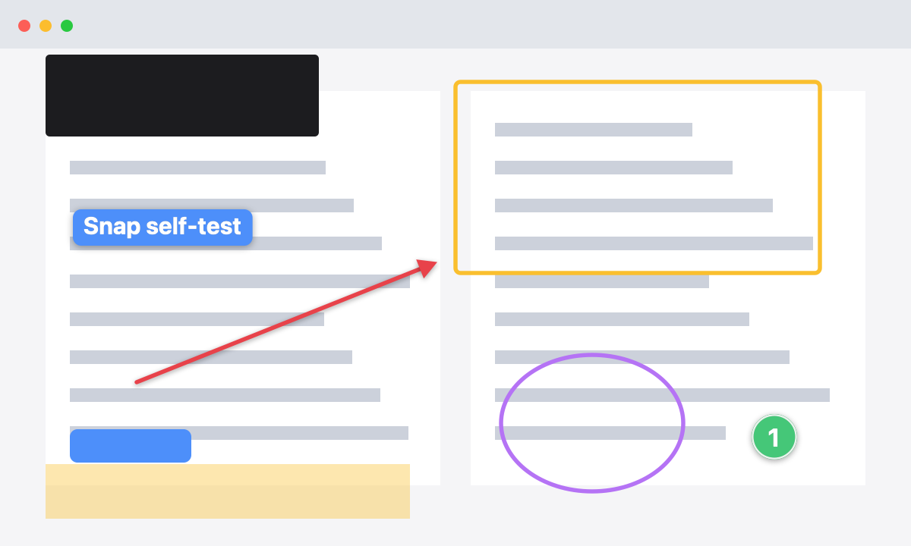

# Snap

A fast, free screenshot tool for macOS with the annotation you actually use. No account, no
upsell, no nag screens.

Press **⇧⌘S**, drag over what you want, mark it up, press **Return**. The image is on your
clipboard and saved to `~/Pictures/Screenshots`.



## Install

```sh
curl -fsSL https://raw.githubusercontent.com/OWNER/REPO/main/install.sh | bash
```

The installer builds Snap from source with Apple's command line tools and puts it in
`~/Applications`. Building locally means macOS trusts the app without a paid signing certificate,
so there is no "unidentified developer" warning. The first capture asks for **Screen Recording**
permission (System Settings › Privacy & Security › Screen & System Audio Recording).

Requires macOS 13 or later. Runs natively on Apple silicon and Intel.

Prefer to build it yourself:

```sh
git clone https://github.com/OWNER/REPO.git snap && cd snap
make install      # build, copy to ~/Applications, launch
```

## Use

| Action | How |
| --- | --- |
| Capture an area | ⇧⌘S, then drag. Press Space while dragging to pick a whole window instead. |
| Capture a window or the full screen | Menu bar icon › Capture Window / Capture Full Screen |
| Annotate an existing image | Menu bar icon › Open Image…, Finder › Open With › Snap, or drop it on the app |
| Copy and close | Return or ⌘C |
| Copy the file path instead (for terminal tools such as Claude Code) | ⇧⌘C |
| Save a copy elsewhere | ⌘S |
| Close | Esc. The capture is already saved and copied; edits are saved to the file. |

### Editor keys

| Key | Tool | | Key | Action |
| --- | --- | --- | --- | --- |
| V | Select, move, delete (Delete key) | | 1–6 | Color |
| A | Arrow (Shift snaps to 45°) | | [ ] | Smaller / larger |
| R | Box (Shift for a square) | | ⌘Z / ⇧⌘Z | Undo / redo |
| O | Ellipse | | Double-click text | Edit it |
| H | Highlight | | | |
| T | Text label | | | |
| B | Redact (a solid bar, not a reversible blur) | | | |
| N | Numbered step (counts up) | | | |
| C | Crop | | | |

The hand button drags the finished PNG into another app.

## Settings

Menu bar icon › Settings… sets the save folder, whether captures go to the clipboard, the ⇧⌘S
shortcut, the menu bar icon, and launch at login.

**Command shortcuts** let Snap's always-running menu bar process own a few extra global shortcuts
that run a shell command, one per line:

```
cmd+shift+a = open -a Terminal
ctrl+option+n = ~/bin/new-note
```

Everything is also scriptable with `defaults write com.baney.snap …` and URLs:

```sh
open snap://capture            # area
open snap://capture/window
open snap://capture/screen
open "snap://open?path=$HOME/Desktop/shot.png"
```

## Privacy

Snap has no network code. Screenshots stay on your Mac. It uses the system `screencapture` tool for
capturing and registers global shortcuts with `RegisterEventHotKey`, which needs no Accessibility or
Input Monitoring permission.

## Develop

```sh
swift test        # drawing model and renderer tests (no window needed)
make app          # universal Snap.app in build/
make selftest     # renders every annotation onto Tests/Fixtures/sample.png
```

`Sources/SnapCore` holds the document model and renderer; the live editor and the exported PNG use
the same drawing code, so what you see is what gets copied. `Sources/Snap` is the AppKit app.

Contributions are welcome. Open an issue first for anything larger than a fix, keep changes covered
by tests in `Tests/SnapCoreTests`, and run `swift test` before sending a pull request.

## License

MIT. See [LICENSE](LICENSE).
