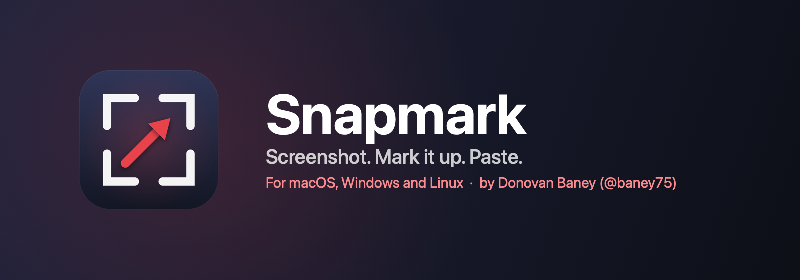
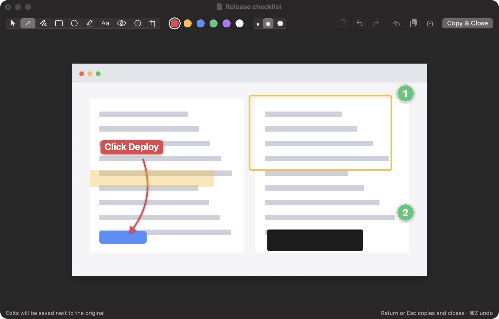

<p align="center">
  
</p>

<p align="center">
  <a href="https://github.com/baney75/snapmark/actions/workflows/ci.yml"></a>
  <a href="https://github.com/baney75/snapmark/releases/latest"></a>
  
  
  
  <a href="LICENSE"></a>
</p>

<p align="center">
  <b>A fast, free screenshot tool with the annotation tools you actually use.</b><br>
  For macOS, Windows and Linux. No account, no upsell, no network code. It lives in your menu bar
  or system tray and stays out of the way.<br>
  <sub>Made by <a href="https://dbaney.com">Donovan Baney</a> · <a href="https://x.com/baney75">@baney75</a></sub>
</p>

<p align="center">
  
</p>

## Install

**macOS** (13 Ventura or later, Apple silicon or Intel)

```sh
curl -fsSL https://raw.githubusercontent.com/baney75/snapmark/main/install.sh | bash
```

The installer builds Snapmark from source with Apple's free command line tools, puts it in
`~/Applications`, and opens a short welcome window that walks you through the one permission it
needs. Because it's built on your Mac, there is no "unidentified developer" warning.

**Windows** (10 or 11, x64), in PowerShell:

```powershell
irm https://raw.githubusercontent.com/baney75/snapmark/main/install.ps1 | iex
```

It installs for your account only, with no administrator prompt. You can also run the
`Snapmark_…_x64-setup.exe` from the [latest release](https://github.com/baney75/snapmark/releases/latest).
Snapmark isn't code-signed on Windows yet, so SmartScreen may ask you to confirm the first time.

**Linux** (x64 or arm64; X11 or Wayland)

```sh
curl -fsSL https://raw.githubusercontent.com/baney75/snapmark/main/install.sh | bash
```

The same command installs the `.deb` on Debian and Ubuntu, the `.rpm` on Fedora and openSUSE, and
the AppImage anywhere else. Packages are also on the
[latest release](https://github.com/baney75/snapmark/releases/latest). On Wayland, desktops keep
global shortcuts to themselves: add one in your keyboard settings that runs `snapmark --capture`.

## How it works

1. **Press ⇧⌘S** (Ctrl+Shift+S on Windows and Linux) and drag over anything. Press Space to grab a
   whole window instead.
2. **Mark it up.** Arrows, boxes, highlights, text, numbered steps, crop and redaction.
3. **Press Return.** The image is on your clipboard, ready to paste into Slack, Mail, a pull request
   or a terminal, and a copy is saved to your Pictures/Screenshots folder.

Captures are saved and copied the moment you take them, so closing the editor never loses anything.

## Features

| | |
| --- | --- |
| **Capture** | Area, window or full screen from a global shortcut, the menu bar, or `snapmark://` URLs |
| **Annotate** | Arrow, box, ellipse, highlight, text label, numbered step, crop |
| **Redact for real** | Redaction draws a solid bar. Blur and pixelation can sometimes be reversed; this can't |
| **Draw past the edge** | Drag a mark outside the screenshot and the canvas grows to fit, filled with the screenshot's own border color, so callouts never get cramped |
| **Edit like a canvas** | New marks are selected as you draw them. Drag handles to resize, Delete to remove, ⌘D to duplicate, arrow keys to nudge, right-click for more |
| **Paste anywhere** | The clipboard gets PNG, TIFF and the file, so chat apps, documents, Finder and terminal tools such as Claude Code all accept it |
| **Safe with your files** | An image you open is never overwritten. Edits go to `name (edited).png` beside it |
| **Retina-correct** | Captures keep their real size when pasted, instead of doubling |
| **Out of the way** | A menu bar or tray icon, no Dock or taskbar clutter, no windows until you need one |
| **Same everywhere** | One config file format, the same tools and keys on macOS, Windows and Linux |
| **Private** | No network code, no analytics, no account. Your screenshots never leave your computer |

## Keyboard

| Key | Tool | | Key | Action |
| --- | --- | --- | --- | --- |
| V | Select and move | | Return | Copy and close |
| A | Arrow (Shift snaps to 45°) | | Esc | Back to Select, then deselect, then copy and close |
| R | Box (Shift for a square) | | Delete | Delete the selected mark |
| O | Ellipse | | ⌘D | Duplicate the selected mark |
| H | Highlight | | Arrow keys | Nudge (Shift: 10 points) |
| T | Text label | | ⌘] / ⌘[ | Bring to front / send to back |
| B | Redact | | ⌘Z / ⇧⌘Z | Undo / redo |
| N | Numbered step | | 1–6, [ ] | Color, smaller / larger |
| C | Crop | | ⇧⌘C | Copy the file path instead of the image |
| | | | ⌘S | Save a copy elsewhere |
| | | | ⌘⌫ | Move the capture to the Trash |

On Windows and Linux, use Ctrl where this table shows ⌘ (Ctrl+Backspace moves a capture to the
Trash, Ctrl+Y also redoes). Tool letters can be changed in Settings or the
[config file](#configuration).

## Permissions

**Windows** and **Linux on X11** need no permissions. **Linux on Wayland** captures through your
desktop's screenshot portal, which may ask once; if your desktop has no portal backend, Snapmark
uses `grim`, `gnome-screenshot` or `spectacle` instead.

On **macOS**, Snapmark needs exactly one permission, **Screen Recording**, and the welcome window asks for it with
one click. If macOS ever shows the switch as on while Snapmark still can't capture, click **Allow…**
again: Snapmark clears its own stale entry and asks fresh. It needs nothing else: no Accessibility, no Input Monitoring. The global shortcut is
registered with `RegisterEventHotKey`, which macOS allows without extra permission.

macOS ties that permission to the app's code signature. Snapmark's installer creates a local signing
certificate the first time it runs, kept in its own keychain under
`~/Library/Application Support/Snapmark/Signing`. The certificate stays the same across updates, so
macOS remembers your choice. It is never added to your login keychain and is trusted for nothing else.

If Screen Recording is ever off, the menu bar menu shows **Allow Screen Recording…** at the top.

## Configuration

Every setting lives in one plain file: **`~/.config/snapmark/config.json`** on macOS and Linux,
**`%APPDATA%\snapmark\config.json`** on Windows. The format is the same everywhere. Change it in
**Settings…**, edit the file yourself, or let a script or AI agent edit it. Snapmark reloads the
moment the file is saved, so there is nothing to restart.

```json
{
  "saveFolder": "~/Pictures/Screenshots",
  "copyOnCapture": true,
  "showMenuBarIcon": true,
  "shortcuts": {
    "captureArea": "cmd+shift+s",
    "captureWindow": "ctrl+shift+2",
    "captureScreen": ""
  },
  "commands": {
    "cmd+shift+a": "open -a Terminal"
  },
  "toolKeys": {
    "select": "v", "arrow": "a", "box": "r", "ellipse": "o", "highlight": "h",
    "text": "t", "redact": "b", "step": "n", "crop": "c"
  }
}
```

| Key | What it does |
| --- | --- |
| `saveFolder` | Where captures are saved. `~` works. |
| `copyOnCapture` | Put every capture on the clipboard as soon as it's taken. |
| `showMenuBarIcon` | Show the menu bar icon. URLs and shortcuts work either way. |
| `shortcuts` | Global shortcuts for `captureArea`, `captureWindow` and `captureScreen`. An empty string turns one off. |
| `commands` | Extra global shortcuts that run a shell command in your login shell. |
| `toolKeys` | The single letter that picks each editor tool. A letter already used by another tool is ignored, so every tool stays reachable. |

Shortcuts are written as modifiers plus one key: `cmd`, `shift`, `option` (or `alt`), `ctrl`, and a
letter, a digit, `space`, `return`, `tab`, `escape` or `f1`–`f12`. On Windows and Linux, `cmd` means
Ctrl, so a file written on a Mac works unchanged; `super` (the Windows key) and a bare `printscreen`
work there too. The default capture shortcut is ⇧⌘S on macOS and Ctrl+Shift+S elsewhere. Any setting you leave out keeps its
default. If the file has a JSON error, Snapmark says so and keeps its current settings rather than
overwriting your file.

On macOS, Snapmark also responds to URLs:

```sh
open snapmark://capture            # area
open snapmark://capture/window
open snapmark://capture/screen
open "snapmark://open?path=$HOME/Desktop/shot.png"
open snapmark://settings
open snapmark://config             # open the config file
open snapmark://reload             # reload it now
```

On Windows and Linux, the same actions are command-line flags. A second launch hands them to the
running copy, which makes them easy to bind to keys on Wayland:

```sh
snapmark --capture            # area
snapmark --capture-window
snapmark --capture-screen
snapmark --open ~/Desktop/shot.png
snapmark --settings
```

## Uninstall

```sh
curl -fsSL https://raw.githubusercontent.com/baney75/snapmark/main/uninstall.sh | bash
```

This quits Snapmark and removes the app and its settings (on macOS, also its signing keychain). Your
screenshots stay where they are. On Windows, uninstall Snapmark from Settings › Apps, or run:

```powershell
irm https://raw.githubusercontent.com/baney75/snapmark/main/uninstall.ps1 | iex
```

## Build from source

```sh
git clone https://github.com/baney75/snapmark.git && cd snapmark
```

**macOS app** (`macos/`, Swift and AppKit):

```sh
cd macos
make install      # build, sign, copy to ~/Applications, launch
make test         # unit tests for the drawing model and renderer
make selftest     # renders every annotation onto a sample image
```

**Windows and Linux app** (`desktop/`, Tauri: Rust plus a TypeScript canvas editor):

```sh
cd desktop
npm ci
npm test                        # editor model tests
cargo test --manifest-path src-tauri/Cargo.toml
npx tauri dev                   # run it
npx tauri build                 # installers in src-tauri/target/release/bundle
```

Linux builds need the WebKitGTK and capture libraries; the exact `apt-get` line is in
[`.github/workflows/ci.yml`](.github/workflows/ci.yml).

Both apps keep the drawing model separate from the windows, so it is unit-tested, and both share
one renderer between the live editor and the exported PNG, so what you see is exactly what gets
copied. The two editors follow the same rules (tools, keys, Esc steps, canvas growth, tool-key
resolution), and the tests check the same cases on each side.

## Contributing

Bug reports and pull requests are welcome. See [CONTRIBUTING.md](CONTRIBUTING.md). For security
issues, see [SECURITY.md](SECURITY.md).

## Author

Snapmark is designed and built by **Donovan Baney**.

[dbaney.com](https://dbaney.com) · [GitHub @baney75](https://github.com/baney75) · [X @baney75](https://x.com/baney75)

## License

[MIT](LICENSE) © 2026 Donovan Baney
