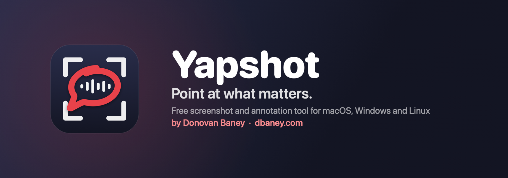
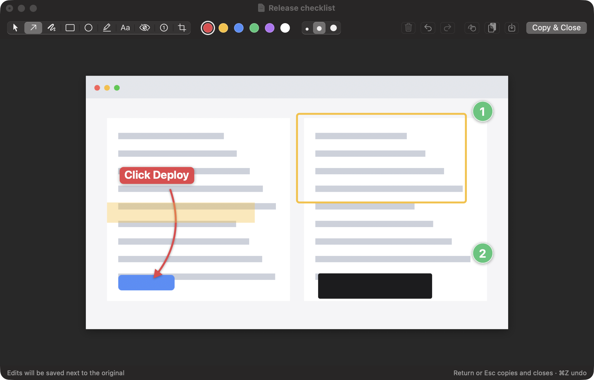

<p align="center">
  
</p>

<h1 align="center">Yapshot</h1>

<p align="center">
  <a href="https://github.com/baney75/yapshot/actions/workflows/ci.yml"></a>
  <a href="https://github.com/baney75/yapshot/releases/latest"></a>
  
  
  
  <a href="LICENSE"></a>
</p>

<p align="center">
  <b>Yapshot is a free, open-source screenshot and annotation tool for macOS, Windows and Linux.</b><br>
  Press a shortcut, drag over anything, circle or point at what matters, and press Return. It's on
  your clipboard, ready to paste. No account, no upsell, no analytics.<br>
  <sub>Made by <a href="https://dbaney.com">Donovan Baney</a> · <a href="https://x.com/baney75">@baney75</a> · Formerly called Shotate, and Snapmark before that</sub>
</p>

<p align="center">
  
</p>

## Install

**macOS** (13 Ventura or later, Apple silicon or Intel)

```sh
curl -fsSL https://raw.githubusercontent.com/baney75/yapshot/main/install.sh | bash
```

The installer builds Yapshot from source with Apple's free command line tools, puts it in
`~/Applications`, and opens a short welcome window that walks you through the one permission it
needs. Because it's built on your Mac, there is no "unidentified developer" warning.

**Windows** (10 or 11, x64), preview, in PowerShell:

```powershell
irm https://raw.githubusercontent.com/baney75/yapshot/main/install.ps1 | iex
```

It installs for your account only, with no administrator prompt. You can also run the
`Yapshot_…_x64-setup.exe` from the [nightly release](https://github.com/baney75/yapshot/releases/tag/nightly).
Yapshot isn't code-signed on Windows yet, so SmartScreen may ask you to confirm the first time.

**Linux** (x64 or arm64; X11 or Wayland), preview

```sh
curl -fsSL https://raw.githubusercontent.com/baney75/yapshot/main/install.sh | bash
```

The same command installs the `.deb` on Debian and Ubuntu, the `.rpm` on Fedora and openSUSE, and
the AppImage anywhere else. Packages are also on the
[nightly release](https://github.com/baney75/yapshot/releases/tag/nightly). On Wayland, desktops keep
global shortcuts to themselves: add one in your keyboard settings that runs `yapshot --capture`.

Stable releases are macOS only for now, because the Mac app is the one each release is tested on.
Windows and Linux get **preview builds**: the nightly, made every day from the newest code. They
have the same tools and update themselves the same way, but may have rough edges.

## How it works

1. **Press ⇧⌘S** (Ctrl+Shift+S on Windows and Linux) and drag over anything. Press Space to grab a
   whole window instead. On macOS 14 and later the screen freezes while you choose, and the editor
   opens the moment you let go.
2. **Mark it up.** Arrows, boxes, highlights, text, numbered steps, crop and redaction.
3. **Press Return.** The image is on your clipboard, ready to paste into Slack, Mail, a pull request
   or a terminal, and a copy is saved to your Pictures/Screenshots folder.

Captures are saved and copied the moment you take them, so closing the editor never loses anything.

## Features

| | |
| --- | --- |
| **Capture** | Area, window or full screen from a global shortcut, the menu bar, or `yapshot://` URLs |
| **Record the screen** | On a Mac with macOS 15 or later: ⇧⌘R records an area you drag (Space picks a window), ⌃⇧⌘R the whole screen the pointer is on. A small bar shows the time and a Stop button, and a red outline marks a recorded area; neither is in the video. Press any record shortcut again, or click Stop, and the MP4 is saved to your screenshots folder and copied as a file. No Finder window opens. Video only: screen recordings never use the microphone |
| **Voice notes** | On a Mac: ⇧⌘M from any app starts recording your voice, and pressing it again stops and copies the audio file to the clipboard. **Voice Notes…** in the menu keeps them all. See [Voice notes](#voice-notes) |
| **Record an app for a demo and a bug report** | ⇧⌘D, then click a window: Yapshot records every window of that app (nothing else on screen) into a folder with the MP4, stills (first and last frames, and up to 6 more, one 0.6 s after each click, skipped when it would land within 0.8 s of an earlier still, so a click within 0.8 s of the previous click with a still, or in the first half second, gets none; with no clicks, a few evenly spaced ones), what the app wrote meanwhile to the system log and to its own log files, any crash report, and `debug.md`. When you stop, `debug.md` is copied: paste it into a coding agent or an issue and it has the errors, the app's log lines and the paths to the video and stills. The video is ready to share as a demo |
| **Scripts from AI agents** | Claude Code, Codex, Cursor or Claude Desktop can send you a script over MCP (local only). It opens in a teleprompter that scrolls while you record a voice note, and the agent can list your saved recordings. `yapshot mcp install` connects them. See [docs/agents.md](docs/agents.md#mcp-server) |
| **Driven by agents** | The `yapshot` command takes screenshots, records, annotates images for docs and exports GIFs and MP4s, printing JSON. Turn on **Let Agents Control Yapshot** in the menu first. Coding agents get a skill for it. See [docs/agents.md](docs/agents.md) |
| **Annotate** | Arrow, pen, box, ellipse, highlight, text label, numbered step, crop |
| **Redact for real** | Redaction draws a solid bar. Blur and pixelation can sometimes be reversed; this can't |
| **Draw past the edge** | Drag a mark outside the screenshot and the canvas grows to fit. The view zooms out as you drag, and the new space continues the screenshot's own edges (a title bar or page background carries on, while lines and text touching the edge don't streak), so callouts never get cramped |
| **Edit like a canvas** | New marks are selected as you draw them. Drag handles to resize, Delete to remove, ⌘D to duplicate, arrow keys to nudge, right-click for more |
| **Text that fits** | Click to type, or drag to set the width it wraps at. Drag a label to move it, its corner to scale it, its side to rewrap it. ⌥Return starts a new line |
| **Lines up by itself** | Dragged marks snap to the edges and centers of the image and of each other, with guides. Hold ⌘ to place freely |
| **Arrows that stay put** | Drop an arrow's end on a mark and it stays attached when that mark moves or resizes |
| **Draw by hand** | The pen draws freehand, and with a drawing tablet the line follows your pressure. Hold still at the end of a stroke and it becomes the clean line, box or ellipse you meant |
| **Curved, labeled arrows** | Drag an arrow's middle handle to curve it. Double-click an arrow's end to type a label it points at; double-click along it to label its middle |
| **Choose what to paste** | On a Mac, turn on "⌘V asks which to paste" in setup, Settings or the menu bar menu. Take screenshots within 3 seconds of each other and, for the next minute, ⌘V opens a panel of them, newest first; click one, press its number, or use the arrow keys and Return, and it pastes where you were typing. A switch in the panel turns it off. Copy anything else and ⌘V works as usual again |
| **Paste anywhere** | The clipboard gets PNG, TIFF and the file, so chat apps, documents, Finder and terminal tools such as Claude Code all accept it |
| **Safe with your files** | An image you open is never overwritten. Edits go to `name (edited).png` beside it |
| **Retina-correct** | Captures keep their real size when pasted, instead of doubling |
| **Out of the way** | A menu bar or tray icon, no Dock or taskbar clutter, no windows until you need one |
| **Same everywhere** | One config file format, the same tools and keys on macOS, Windows and Linux |
| **Private** | No analytics, no account. Your screenshots, recordings and voice notes never leave your computer. The only network request is a daily update check, which you can turn off |
| **Easy updates** | Yapshot checks once a day and updates itself with one click from its menu. On a Mac, pick Stable or Nightly in Settings |

## Keyboard

| Key | Tool | | Key | Action |
| --- | --- | --- | --- | --- |
| V | Select and move | | Return | Copy and close |
| A | Arrow (Shift snaps to 45°) | | Esc | Back to Select, then deselect, then copy and close |
| R | Box (Shift for a square) | | Delete | Delete the selected mark |
| O | Ellipse | | ⌘D | Duplicate the selected mark |
| H | Highlight | | Arrow keys | Nudge (Shift: 10 points) |
| T | Text label | | ⌘] / ⌘[ | Bring to front / send to back |
| B | Redact | | ⌘Z / ⇧⌘Z | Undo / redo |
| N | Numbered step | | 1–6, [ ] | Color, smaller / larger |
| C | Crop | | ⇧⌘C | Copy the file path instead of the image |
| P | Pen (hold still to make a shape) | | ⌥⌘C / ⌥⌘V | Copy a mark's style / paste it onto the selection |
| | | | ⌘S | Save a copy elsewhere |
| | | | ⌘⌫ | Move the capture to the Trash |

On Windows and Linux, use Ctrl where this table shows ⌘ (Ctrl+Backspace moves a capture to the
Trash, Ctrl+Y also redoes). Tool letters can be changed in Settings or the
[config file](#configuration).

## Voice notes

On a Mac, press ⇧⌘M in any app. A small badge at the top of the screen shows the time, your voice
level, and clickable Stop and Close buttons, and the app you're in keeps the keyboard. Press ⇧⌘M
again (or click Stop) and Yapshot stops recording, saves the file, and puts the audio file on the
clipboard. Press Esc or click the close button to dismiss the badge at any time. Screen recording
can run at the same time.

**Voice Notes…** in the menu bar menu opens the library: record (⌘R, with pause and ⌘B markers),
search by name, play at any speed, copy the audio file, rename, show in Finder, move to the Trash,
or drag a note out as a file. Notes are plain audio files in `~/Music/Voice Notes`, with markers
in a hidden `.meta` folder beside them. Pick the folder, AAC, Apple Lossless or WAV, and stereo in
**Settings › Voice Notes**. Quitting mid note saves it.

**Scripts** in the menu bar menu (and the Voice Notes window) opens a script in the teleprompter: a
floating panel in large white type that leaves the keyboard with the app you're in. Press Record
and it scrolls as you read; hold it, scroll by hand, change the speed or the text size. The voice
note remembers the script it was read from. Scripts are Markdown files in `Scripts/` inside the
voice notes folder; AI agents send them over MCP (see [docs/agents.md](docs/agents.md#mcp-server)).

| Shortcut | Does |
| --- | --- |
| ⇧⌘R | Record an area of the screen (Space picks a window); again to stop |
| ⇧⌘M | Start a voice note; again to stop and copy the audio file |

A config file from 0.14.0 that still has `recordArea` on ⌥⇧⌘R and `voiceNote` on ⇧⌘R migrates once
back to ⇧⌘R for recording and ⇧⌘M for voice notes. Shortcuts you customized yourself stay, and
neither key steals a shortcut already in use.

## Updates

Yapshot checks GitHub once a day and shows **Update to Yapshot x.y.z…** at the top of its menu
when there is one. Click it, or **Check for Updates…**, and it installs itself and restarts. Your
settings, shortcuts and permission stay as they are.

On a Mac, pick a channel in **Settings › General › Updates**:

- **Stable** (the default) gets tested releases.
- **Nightly** is built every day from the newest code. It gets fixes first and may have rough
  edges. Switch back to Stable any time.

Windows and Linux follow Nightly, since stable releases are macOS only for now.

On macOS an update is built from source on your Mac, like the install command, so macOS keeps the
Screen Recording permission. On Windows and Linux the installer is checked against its SHA-256
before it runs. To install a channel directly, or to update from a terminal, run the install
command again (on a Mac, add `-s -- --nightly` after `bash` for nightly). How it works:
[docs/updates.md](docs/updates.md).

## Permissions

**Windows** and **Linux on X11** need no permissions. **Linux on Wayland** captures through your
desktop's screenshot portal, which may ask once; if your desktop has no portal backend, Yapshot
uses `grim`, `gnome-screenshot` or `spectacle` instead.

On **macOS**, Yapshot needs one permission, **Screen Recording**, and the welcome window asks for it with
one click. Voice notes add **Microphone** (only while a voice note you started records); macOS asks
the first time you use it. If macOS ever shows the switch as on while Yapshot still can't capture, click **Allow…**
again: Yapshot clears its own stale entry and asks fresh. It needs no Input Monitoring, and Accessibility only if you turn on the paste chooser, which types the paste for you. The global shortcut is
registered with `RegisterEventHotKey`, which macOS allows without extra permission.

macOS ties that permission to the app's code signature. Yapshot's installer creates a local signing
certificate the first time it runs, kept in its own keychain under
`~/Library/Application Support/Snapmark/Signing` (it keeps the app's old name). The certificate
stays the same across updates, so macOS remembers your choice. It is never added to your login keychain and is trusted for nothing else.

If Screen Recording is ever off, the menu bar menu shows **Allow Screen Recording…** at the top.

## Configuration

Every setting lives in one plain file: **`~/.config/yapshot/config.json`** on macOS and Linux,
**`%APPDATA%\yapshot\config.json`** on Windows. The format is the same everywhere. Change it in
**Settings…**, edit the file yourself, or let a script or AI agent edit it. Yapshot reloads the
moment the file is saved, so there is nothing to restart. Settings from Shotate or Snapmark, the
app's old names, carry over the first time Yapshot starts.

```json
{
  "saveFolder": "~/Pictures/Screenshots",
  "copyOnCapture": true,
  "showMenuBarIcon": true,
  "updateChannel": "stable",
  "checkForUpdates": true,
  "shortcuts": {
    "captureArea": "cmd+shift+s",
    "captureWindow": "ctrl+shift+2",
    "captureScreen": "cmd+ctrl+shift+s",
    "recordArea": "cmd+shift+r",
    "recordScreen": "cmd+ctrl+shift+r",
    "recordApp": "cmd+shift+d",
    "voiceNote": "cmd+shift+m"
  },
  "voiceFolder": "~/Music/Voice Notes",
  "voiceQuality": "aac",
  "voiceStereo": false,
  "commands": {
    "cmd+shift+a": "open -a Terminal"
  },
  "toolKeys": {
    "select": "v", "arrow": "a", "pen": "p", "box": "r", "ellipse": "o", "highlight": "h",
    "text": "t", "redact": "b", "step": "n", "crop": "c"
  }
}
```

| Key | What it does |
| --- | --- |
| `saveFolder` | Where captures are saved. `~` works. Settings offers Pictures › Screenshots, Desktop, Downloads or any folder. |
| `copyOnCapture` | Put every capture on the clipboard as soon as it's taken. |
| `showMenuBarIcon` | Show the menu bar icon. URLs and shortcuts work either way. |
| `shortcuts` | Global shortcuts for `captureArea`, `captureWindow`, `captureScreen`, and on macOS 15 `recordArea`, `recordScreen` and `recordApp` (any record shortcut again stops recording), and on macOS `voiceNote`. An empty string turns one off. A shortcut added in a new version starts off if your file already uses its keys. |
| `commands` | Extra global shortcuts that run a shell command in your login shell. |
| `voiceFolder` | macOS: where voice notes are saved. `~` works. |
| `voiceQuality` | macOS: `aac`, `alac` (Apple Lossless) or `wav`. |
| `voiceStereo` | macOS: record voice notes in two channels. Off suits the built-in microphone. |
| `updateChannel` | macOS: `stable` or `nightly`. Leave it out to follow the build you installed. Windows and Linux always follow `nightly`. |
| `checkForUpdates` | Check GitHub for updates once a day. `false` means Yapshot makes no network request at all. |
| `toolKeys` | The single letter that picks each editor tool. A letter already used by another tool is ignored, so every tool stays reachable. |
| `agentControl` | macOS: let the `yapshot` command and coding agents capture and record without a click. Off by default. |
| `appLogs` | macOS: more folders to read an app's log files from while ⇧⌘D records it, by bundle ID or app name, e.g. `{"com.t3tools.t3code": ["~/.t3/userdata/logs"]}`. ~/Library/Logs/<app> and files the app has open are found on their own. |

Shortcuts are written as modifiers plus one key: `cmd`, `shift`, `option` (or `alt`), `ctrl`, and a
letter, a digit, `space`, `return`, `tab`, `escape` or `f1`–`f12`. On Windows and Linux, `cmd` means
Ctrl, so a file written on a Mac works unchanged; `super` (the Windows key) and a bare `printscreen`
work there too. The default capture shortcut is ⇧⌘S on macOS and Ctrl+Shift+S elsewhere. Any setting you leave out keeps its
default. If the file has a JSON error, Yapshot says so and keeps its current settings rather than
overwriting your file.

On macOS, Yapshot also responds to URLs:

```sh
open yapshot://capture            # area
open yapshot://capture/window
open yapshot://capture/screen
open yapshot://record             # pick an area and record it; again to stop (macOS 15+)
open yapshot://record/screen
open yapshot://record/app         # click a window: record that app, its logs and stills
open yapshot://record/stop
open "yapshot://open?path=$HOME/Desktop/shot.png"
open yapshot://settings
open yapshot://config             # open the config file
open yapshot://reload             # reload it now
open yapshot://update             # check for updates now
```

On Windows and Linux, the same actions are command-line flags. A second launch hands them to the
running copy, which makes them easy to bind to keys on Wayland:

```sh
yapshot --capture            # area
yapshot --capture-window
yapshot --capture-screen
yapshot --open ~/Desktop/shot.png
yapshot --settings
```

## Uninstall

```sh
curl -fsSL https://raw.githubusercontent.com/baney75/yapshot/main/uninstall.sh | bash
```

This quits Yapshot and removes the app and its settings (on macOS, also its signing keychain), and
any copy installed under its old names, Shotate and Snapmark. Your
screenshots stay where they are. On Windows, uninstall Yapshot from Settings › Apps, or run:

```powershell
irm https://raw.githubusercontent.com/baney75/yapshot/main/uninstall.ps1 | iex
```

## Build from source

```sh
git clone https://github.com/baney75/yapshot.git && cd yapshot
```

**macOS app** (`macos/`, Swift and AppKit):

```sh
cd macos
make install      # build, sign, copy to ~/Applications, launch
make test         # unit tests for the drawing model and renderer
make selftest     # renders every annotation onto a sample image
```

**Windows and Linux app** (`desktop/`, Tauri: Rust plus a TypeScript canvas editor):

```sh
cd desktop
npm ci
npm test                        # editor model tests
cargo test --manifest-path src-tauri/Cargo.toml
npx tauri dev                   # run it
npx tauri build                 # installers in src-tauri/target/release/bundle
```

Linux builds need the WebKitGTK and capture libraries; the exact `apt-get` line is in
[`.github/workflows/ci.yml`](.github/workflows/ci.yml).

Both apps keep the drawing model separate from the windows, so it is unit-tested, and both share
one renderer between the live editor and the exported PNG, so what you see is exactly what gets
copied. The two editors follow the same rules (tools, keys, Esc steps, canvas growth, tool-key
resolution), and the tests check the same cases on each side.

## Contributing

Bug reports and pull requests are welcome. See [CONTRIBUTING.md](CONTRIBUTING.md). For security
issues, see [SECURITY.md](SECURITY.md).

## Author

Yapshot is designed and built by **Donovan Baney**.

[dbaney.com](https://dbaney.com) · [GitHub @baney75](https://github.com/baney75) · [X @baney75](https://x.com/baney75)

## License

[MIT](LICENSE) © 2026 Donovan Baney

## Sponsors

<!-- sponsors:start -->
No sponsors yet. [Sponsor on GitHub](https://github.com/sponsors/baney75) and your name appears here automatically.
<!-- sponsors:end -->
